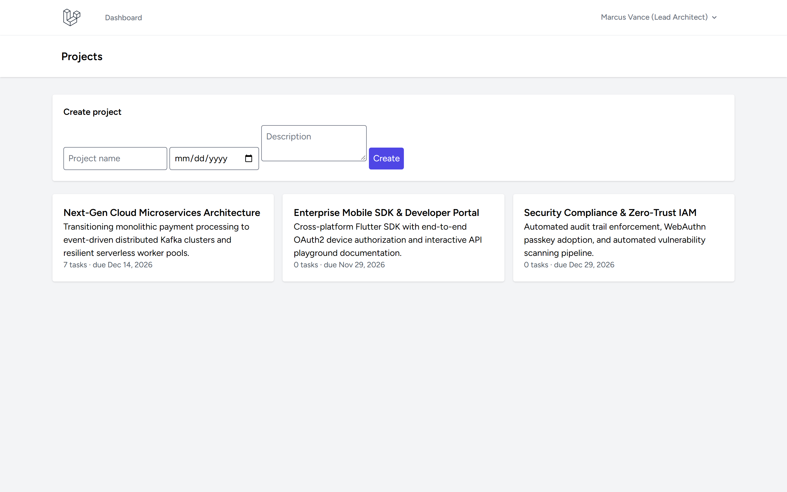
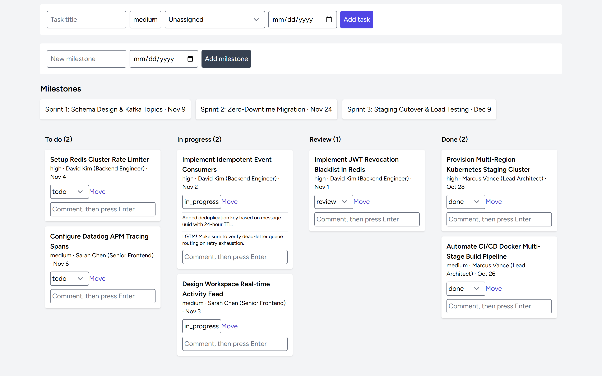
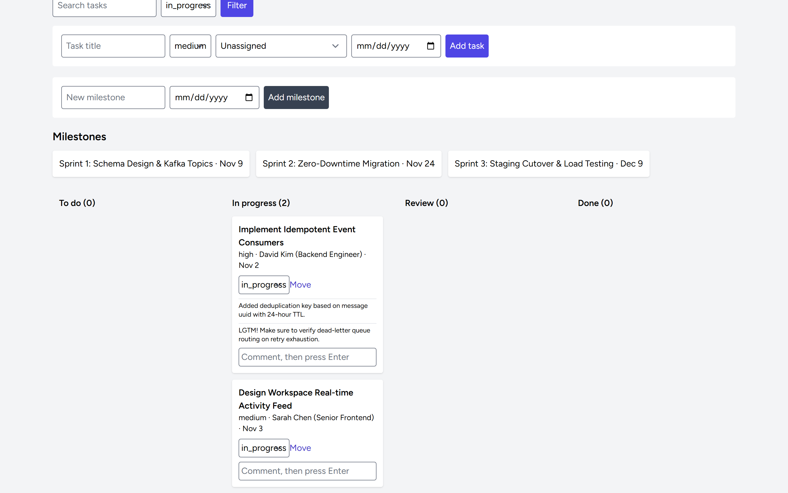
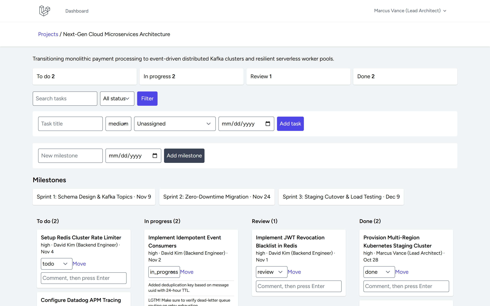

# Project Management Laravel

Standalone Laravel project and task manager with authenticated project membership, Kanban workflow, task assignments, comments, milestones, search, progress metrics, and activity records.

---

## Screenshots

| Tampilan | Preview |
|---|---|
| **Direktori Portofolio & Inisiasi Proyek**<br>Daftar seluruh inisiatif proyek tim aktif, jumlah beban tugas, tenggat waktu (deadline), dan formulir pembuatan proyek baru |  |
| **Papan Tugas Kanban & Alur Kerja Tim**<br>Manajemen visual 4 kolom alur kerja (To do, In progress, Review, Done) dengan kartu tugas, prioritas, penanggung jawab, dan pemindahan status cepat |  |
| **Detail Tugas & Kolaborasi Diskusi Tim**<br>Filter tugas terfokus, riwayat diskusi komentar real-time pada kartu tugas, dan form penambahan tanggapan tim |  |
| **Metrik Beban Kerja & Pencapaian Milestone**<br>Kartu ringkasan kuantitatif status tugas per kategori serta pelacakan target milestone sprint proyek |  |

---

## Setup (Windows PowerShell)

```powershell
Copy-Item .env.example .env
php C:/Users/wondr/.config/herd-lite/bin/composer.phar install
npm install
php artisan key:generate
php artisan migrate --seed
npm run build
php artisan serve
```

Register an account at `/register`; there are no seeded users or private sample records. Project creators become members. Project reads and task changes are membership-scoped; non-members receive 404. Statuses are `todo`, `in_progress`, `review`, `done`; priority is low/medium/high. Assignees must belong to the project.

## Validation

```powershell
php artisan migrate:fresh --seed
php artisan test --compact
npm run build
php C:/Users/wondr/.config/herd-lite/bin/composer.phar validate --no-check-publish
php C:/Users/wondr/.config/herd-lite/bin/composer.phar audit
npm audit --omit=dev
```

## Limitations

Membership invitation/administration, role-specific policy, notifications, task edit/delete, complete/tamper-evident audit history are not implemented. All project members may update supported statuses; recorded role is not currently used for differential permissions. Configure HTTPS, secure sessions, backups, least-privilege operational access, and mail delivery before deployment. Functional starter, not compliance-certified.

No `.env`, personal data, `vendor`, `node_modules`, or build output is tracked.

MIT license.
